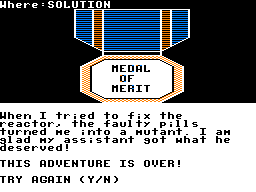

# Major Istar para MSX

Conversão experimental de **Major Istar — Under the Doomed Sea**, de B. J. Chambless / Computerware (1984), a partir do arquivo CoCo fornecido para este projeto.

## Versão atual — controles corrigidos, 24/10/2026

As **quatro edições concluíram as 78 etapas do walkthrough no openMSX**, incluindo atracação, três travessias das áreas de segurança, reparo do reator e resgate do diretor. Todas chegaram a **THIS ADVENTURE IS OVER!** e **TRY AGAIN (Y/N)**.

| Computador | Imagem atual |
|---|---|
| MSX1 — ROM 32 KiB | [MISTAR_MSX1.ROM](roms/MISTAR_MSX1.ROM) |
| MSX1 — DSK 720 KiB | [MISTAR_MSX1.DSK](roms/MISTAR_MSX1.DSK) |
| MSX2 — ROM 32 KiB | [MISTAR_MSX2.ROM](roms/MISTAR_MSX2.ROM) |
| MSX2 Panasonic — turbo automático | [MISTAR_MSX2_PANASONIC_TURBO.ROM](roms/MISTAR_MSX2_PANASONIC_TURBO.ROM) |

[Baixar pacote completo da revisão](downloads/MISTAR-MSX-controles-corrigidos-completo.zip) · [Instruções e fontes](edicoes/controles-corrigidos/LEIA-ME.md) · [Relatório de validação](edicoes/controles-corrigidos/VALIDACAO.json) · [Hashes](roms/SHA256.json).

## Uso

Carregue a ROM como cartucho ou inicialize pelo DSK. Pressione Espaço no título e nas instruções. Digite comandos em inglês no aviso OK. **Nas fases arcade, use as setas ou joystick na porta 1**; o botão A ou Espaço continua as instruções. F1 alterna azul/laranja.

Na edição Panasonic, o turbo compatível é ativado automaticamente. F2, no prompt ou espera de teclado, alterna turbo/normal. Shift mantido ao iniciar conserva 3,58 MHz. Essa ROM exige MSX2 e permanece no clock normal quando não detecta o turbo Panasonic. Não ativa R800.

SAVE 1 e LOAD 1 nas ROMs usam RAM, perdida ao reiniciar. O DSK oferece slots 1 a 9 nos arquivos reservados da imagem; use uma cópia gravável e não mova nem desfragmente esses arquivos. O DSK distribuído tem os slots vazios.

## Correções e validação

A revisão corrige o vetor de leitura do joystick, atualiza o vídeo durante as fases de ação, substitui suas longas esperas por uma base de tempo de VBlank, adapta chamadas de som do CoCo e amplia a memória virtual para um ponteiro temporário usado ao desenhar objetos.

Foram executadas 206 entradas de texto por edição e os quatro segmentos arcade, usando somente teclado emulado. O depurador observa o estado para escolher os movimentos automáticos, sem alterar a memória do jogo, injetar saves ou pular etapas. O jogador automático está nos testes, não nas ROMs. SAVE/LOAD, testes do núcleo e regressões gráficas também passaram. A VRAM final foi conferida byte a byte contra a conversão esperada.

As evidências estão em [testes](edicoes/controles-corrigidos/testes/). Os arquivos de framebuffer e os textos extraídos documentam as telas finais; capturas do renderizador podem conservar um quadro anterior durante execução acelerada fora da tela. Não houve teste em MSX ou joystick físico. A validação cobre o percurso descrito, sem garantir todas as combinações possíveis de comandos.

## Fontes e análises

- [Fontes atuais MSX1, DSK e MSX2](edicoes/controles-corrigidos/padrao/fontes/).
- [Fontes atuais Panasonic turbo](edicoes/controles-corrigidos/panasonic-turbo/fontes/).
- [Análise do original 6809](analise/original-6809/) e evidências REA/Ghidra em `analise/` e nas edições.
- Os arquivos disponíveis nesta versão do repositório são os da edição corrigida. As entregas anteriores foram substituídas; seus registros permanecem no histórico de commits.
- [Falha identificada no teste anterior](analise/teste-walkthrough-anterior/RELATORIO.md), corrigida nesta revisão.

Para compilar, use Python e SDCC conforme o LEIA-ME. Dentro da edição desejada, execute `python fontes/build.py --sdcc "CAMINHO/DO/SDCC"`. Atalhos e scripts de teste preservam alguns caminhos do computador de desenvolvimento; ajuste-os em outra instalação.

O motor continua híbrido: inicialização, texto e gráficos nativos Z80, e parte da lógica original num núcleo de compatibilidade 6809 compilado para Z80. Não corresponde à recuperação integral do fonte original.

## Créditos

Os direitos do jogo original permanecem com seus titulares. Esta publicação não concede uma nova licença sobre seus dados. Consulte [Ferramentas e licenças](edicoes/controles-corrigidos/padrao/fontes/FERRAMENTAS-E-LICENCAS.md). Foram usados REA, Ghidra, f9dasm, SDCC e openMSX. Nenhum BIOS, credencial ou instalação de ferramenta acompanha o repositório.
